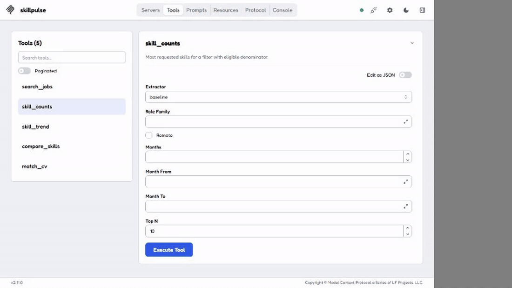

# SkillPulse Agent

A job-market analyser over Hacker News' monthly **"Ask HN: Who is hiring?"** threads.
Workers collect the posts on a schedule, an LLM extracts the skills each post asks for,
and a LangGraph agent answers questions about skill demand and trends using only database
results. The same read-only tools are exposed through an MCP server.

Every number the agent reports comes from a SQL query, and every quality number below comes
from a command you can re-run. Design: [SPEC.md](SPEC.md). Decisions:
[docs/decisions.md](docs/decisions.md).

Five read-only tools, shared by the agent and the MCP server: `search_jobs`,
`skill_counts`, `skill_trend`, `compare_skills`, `match_cv`.

## Results

| What | Dataset | Result |
|------|---------|--------|
| Baseline extraction (alias matcher) | 40 synthetic posts | micro-F1 0.991, macro-F1 0.9783 |
| LLM extraction (S2) | same 40 posts | micro-F1 **0.9552**, macro-F1 0.9442, required-accuracy 0.925, unknown-rate 0.006 — `nvidia/nemotron-3-super-120b-a12b` |
| Agent answers (S3, correctness) | 64 questions, 222 facts | correctness **0.9219** (59/64), tool-selection 0.9796, facts 214/222 |
| Agent grounding (S4) | same | **1.0** — every number in an answer traced to a tool result |

Both real-model rows use `nvidia/nemotron-3-super-120b-a12b` over an OpenAI-compatible
NVIDIA NIM endpoint, chosen by screening the key's live catalogue rather than by
reputation ([D009](docs/decisions.md)), run with `SKILLPULSE_AGENT_LLM_TIMEOUT_SECONDS=60`.
Every row above is **synthetic data**: live Hacker News text stays gated
([D006](docs/decisions.md)), so none of these is a real-data result and none is a claim
about real hiring demand.

Five of the 64 agent questions fail, and they are named rather than smoothed over
([D011](docs/decisions.md)): one drops a role filter the question states, one reaches for
`skill_counts` where the question is about a CV, and three ask about a year the fixture does
not cover. The committed result JSON lists every case, so the failures can be re-read
directly.

The harness itself is verified with a deterministic **fake model**: 222/222 facts passed,
correctness 1.0, grounding 1.0. That is a contract check on the scorer and the grounding
gate, not a model-quality result. PR checks use it so CI stays free and keyless.

## Quick start

```bash
cp .env.example .env          # then edit if needed
make install                  # uv sync
make db-up                    # Postgres 16 on localhost:5433
make redis-up                 # Redis 7 on localhost:6379
make migrate                  # alembic upgrade head

make threads                  # list the hiring threads found on HN
make fetch THREAD=49922569    # fetch one thread's posts
```

Fetch a bounded window of recent threads, newest first:

```bash
uv run skillpulse backfill --limit 3
```

**Live Hacker News access is gated and off by default.** `threads`, `fetch`, `backfill`
and the workers refuse to run unless `SKILLPULSE_HN_LIVE_FETCH_ENABLED=true`, because
authorization to store HN post text is unresolved. The flag opens the gate; it is not a
claim of permission. See [docs/terms.md](docs/terms.md).

## Workers

Start a worker and the scheduler in two terminals (Postgres and Redis must be up):

```bash
make worker                   # celery -A skillpulse.workers.app worker --pool=solo
make beat                     # celery -A skillpulse.workers.app beat
```

Beat refreshes the current and previous month's threads every 6 hours
(`SKILLPULSE_CELERY_UPDATE_INTERVAL_SECONDS`, default 21600) and runs a nightly refresh of
the trend views. `worker-skills` extracts pending posts in bounded batches. Re-running a
fetch creates zero duplicates (upsert on the HN item id), and a failed run resumes from
where it stopped.

## MCP server

The MCP server reuses the same read-only tools as the agent, so it needs no separate SQL.
Give it a read-only database login; the local Kubernetes deployment supplies its own.

```bash
# stdio (for Claude Desktop and other MCP clients)
.venv/Scripts/python.exe -m skillpulse.mcp_server --transport stdio
.venv/Scripts/python.exe -m skillpulse.mcp_server --transport stdio --fixture   # fixture DB, no Postgres

# streamable HTTP (loopback only, DNS-rebinding protection on)
.venv/Scripts/python.exe -m skillpulse.mcp_server --transport streamable-http --port 8765
```

`skillpulse-mcp` is an alias of the same entry point, and `skillpulse://taxonomy` is a
read-only resource so a client can pick valid skill ids. A ready Claude Desktop config is
at [docs/claude-desktop-mcp.example.json](docs/claude-desktop-mcp.example.json).

### Inspector demo (synthetic data)

MCP Inspector **2.11.0** connects over stdio to `skillpulse-mcp --fixture`, lists all five
tools, and runs `skill_counts`. The result has eight rows over 480 fixture posts. These are
synthetic counts: no HN access, no model call, no Desktop configuration.



## API

`uv run uvicorn skillpulse.api.app:app` serves `POST /v1/ask` (the agent answer, streamed
over SSE), `GET /v1/skills/top`, `/v1/skills/{id}/trend`, `/v1/coverage`, `/healthz`,
`/readyz` and `/metrics`. `/v1/ask` needs a configured agent model; without one it returns
`503` rather than inventing an answer. Stats endpoints report the post count behind every
share and withhold a share below 30 posts.

## Kubernetes

```bash
make up                       # build images, install the chart on a local k3d cluster
make smoke                    # end-to-end smoke test against the running stack
make down                     # delete the cluster
```

`make up` creates the k3d cluster and registry, builds the images, then runs `terraform
apply`, which installs the CloudNativePG operator and a Postgres cluster before the Helm
chart. `make secrets` creates the Kubernetes Secret from `.env` with `kubectl`, so no secret
enters the chart, the Terraform state or version control. Every Deployment runs non-root
with resource limits and probes; `beat` is pinned to one replica with the `Recreate`
strategy. CI runs the same install and smoke test on every PR. The runbook is
[docs/deployment.md](docs/deployment.md).

## Tests and evaluation

```bash
make check                    # ruff + mypy (strict) + unit tests, no Docker needed
make test-integration         # real Postgres 16 via testcontainers (needs Docker)

uv run skillpulse taxonomy            # print the loaded taxonomy
uv run skillpulse eval extraction     # baseline F1 -> eval/results/baseline_synthetic.json
uv run skillpulse eval agent          # fixture + fake model -> eval/results/agent_fixture_fake.json

# real-model runs (need SKILLPULSE_LLM_* / SKILLPULSE_AGENT_LLM_* and `make redis-up`)
uv run skillpulse eval extraction --extractor llm
uv run skillpulse eval agent --real-model \
  --dataset eval/datasets/agent_eval_cases.json \
  --fixture-profile synthetic --source synthetic_fixture
```

A real run needs a provider, so CI uses the fake model. The committed results use
`SKILLPULSE_LLM_BASE_URL=https://integrate.api.nvidia.com/v1` with
`SKILLPULSE_LLM_MODEL=nvidia/nemotron-3-super-120b-a12b`, and the key in
`SKILLPULSE_LLM_API_KEY` / `SKILLPULSE_AGENT_LLM_API_KEY`. The agent set and the five-year
fixture are committed and hold no post text, so a reader can reproduce any number. The
agent must not quote a share based on fewer than 30 posts, and expected facts are computed
by SQL over the raw fixture tables, not by the tools under test.

## Layout

```
src/skillpulse/
  hn_client.py        HN API client: typed items, token bucket, retries
  text_cleaning.py    HTML -> text, PII stripping, thread-title month parsing
  models.py           SQLAlchemy models: threads, posts, fetch_runs, skills
  fetch_service.py    find threads, fetch a thread, back-fill
  extraction/         taxonomy loader, baseline + LLM extractors, persistence
  trends.py           trend statistics over the materialised views
  tools/              the five read-only tools (shared by the agent and the MCP server)
  mcp_server/         MCP server: stdio + streamable HTTP
  agent/              LangGraph graph, model adapters, grounding check
  api/app.py          FastAPI stats endpoints and /v1/ask SSE
  workers/            Celery app, beat schedule, fetch + extract tasks
  eval/               labelled-set scoring, fixture DB, dataset builder, agent evaluation
  cli.py              skillpulse threads | fetch | backfill | extract | eval | refresh-trends
config/               skills.yaml (336 skills, 13 categories), role_families.yaml
alembic/              migrations: 0001 ingestion, 0002 extraction/trends, 0003 read-only role
eval/                 datasets (no post text), committed results, baseline_agent.json
deploy/helm/          the Helm chart
infra/                Terraform: namespace, CloudNativePG, Postgres, Redis, Helm release
tests/                unit tests + Postgres/Redis testcontainers integration tests
docs/                 decisions.md, terms.md, deployment.md
```

## Data source, terms and attribution

Data comes only from the official Hacker News API
(`https://hacker-news.firebaseio.com/v0/`, no key). Every post is attributable to
`https://news.ycombinator.com/item?id=<id>`. Emails and phone numbers are stripped before
storage, the HN username (`by`) is not stored, and post text stays in the local database and
is never exported. Only counts, metadata and links leave it.

**Limits:** the data leans toward US and remote roles, has few European on-site posts, and
almost no Greek ones. It reflects companies that post on Hacker News, not the whole market.
The committed evaluation datasets are synthetic, so they are public and carry no personal
data. Live authorization is unresolved — see [docs/terms.md](docs/terms.md).

## Status

Ingestion, extraction, trends, the agent, the MCP server, the Helm chart and CI are built
and tested, and the real-model results above are committed. What remains is the last
documentation trim ([SPEC §15](SPEC.md) R3) and the tagged `v1.0.0` release.

## Licence

MIT for the code. Post text is not republished.
